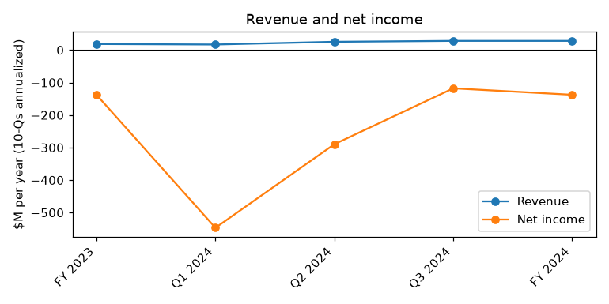
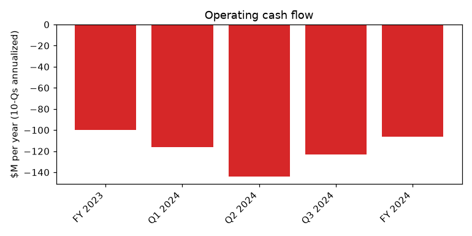
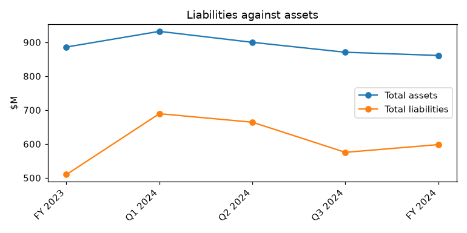

# Li-Cycle Holdings Corp. (CIK 1828811): 10-K for the period ending 2024-12-31, filed 2025-03-31, model score 0.640

## Answer

The 0.640 score comes from a net loss of $137.7 million (-16% of assets, 9th peer percentile), operating cash burn of $106.4 million, tiny revenue (4th percentile) and a current ratio of 0.58 against a peer median of 0.8. Leverage of 0.69 is close to the peer median of 0.68, so it does not explain the score. The filings show the distress is real.

## Verdict

- **Verdict:** real risk
- **My own risk:** very high, roughly 45%
- **Agree with the model:** yes

## The numbers ($ million)

| Input | This report | Year before | % of assets | Peer percentile | What drives it |
|---|---|---|---|---|---|
| Total assets | 861.2 | 886.0 | 100.0 | 20 | Substantially all pledged to lenders |
| Current assets | 86.4 | 149.0 | 10.0 | 62 | Cash down to $22.6M |
| Current liabilities | 150.0 | 156.7 | 17.4 | 82 | Current ratio 0.58 vs peer median 0.8 |
| Total liabilities | 598.1 | 509.6 | 69.4 | 55 | Convertible notes growing with PIK interest |
| Revenue | 28.0 | 18.3 | 3.3 | 4 | Small base, cannot carry costs |
| Net income | -137.7 | -138.0 | -16.0 | 9 | Costs far above revenue |
| Operating income | -125.5 | -162.6 | -14.6 | 9 | Loss narrowed but still large |
| Operating cash flow | -106.4 | -99.8 | -12.4 | 7 | Burn slowed in late 2024 (Q4 ~-$13.9M) |

Peers: 153; year-before from this filing's prior-year column.

## Main reasons

1. **Cash runs out within months** (from the filings). Cash was $22.6M at December 31, 2024. My calculation: about 2.5 to 4.9 months at the FY2024 or Q4 2024 burn, shortened by the $10.0M monthly minimum liquidity covenant. "As of December 31, 2024, Li-Cycle held cash and cash equivalents of $22.6 million." (10-K, 2025-03-31, Item 1A. Risk Factors - substantial doubt about going concern)
2. **Management names bankruptcy as a possible outcome** (from the filings). It needs near-term financing to fund the next twelve months. "may therefore need to significantly modify or terminate operations or dissolve and liquidate its assets under applicable bankruptcy laws or otherwise file for bankruptcy protection." (10-K, 2025-03-31, Item 1A. Risk Factors)
3. **The DOE loan cannot be drawn** (from the filings). The facility is up to $475.0M but needs ~$173.0M of base equity; federal disbursements were paused January 20, 2025. "We are presently aware of no such sources of financing to fund the base equity contribution we are required to provide as a condition to drawing on the DOE Loan Facility." (10-K, 2025-03-31, Item 1A. Risk Factors - DOE Loan Facility)
4. **Lender-led deal with little for shareholders, after delisting** (from the filings). Glencore (~66% fully diluted) sent a letter of interest March 14, 2025; NYSE trading was suspended February 26, 2025. "Given the Company’s current financial position, the terms of any such strategic transaction may assign limited or no value to the Company’s existing equity." (10-K, 2025-03-31, Item 1A. Risk Factors - additional third-party financing) My inference: a typical setup for a court-supervised sale or restructuring.
5. **Deep losses, burn and weak liquidity** (model input). Net income -$137.7M (9th percentile), operating cash flow -$106.4M (7th), revenue $28.0M (4th), current ratio 0.58 vs peer median 0.8. "Li-Cycle expects to incur net losses in the future and may never achieve sustained profitability." (10-K, 2025-03-31, Item 1A. Risk Factors - history of losses)

Also in the filings: mechanic's liens of ~$64.0M, $36.0M and $5.1M, MasTec's $48.7M arbitration and foreclosure action, and $89.7M of unpaid Rochester Hub costs.

## Evidence against

- Main maturities are 2026-2027 and Glencore interest is paid in kind, so no large cash debt payment is due within 12 months.
- DOE facility closed, no principal due before June 2027: "On November 7, 2024, Li-Cycle entered into an agreement for a loan facility of up to $475.0 million" (10-K, 2025-03-31, Item 1. Business - Support from Government Programs)
- Glencore keeps supporting the company ($75M in 2024, waivers); an out-of-court takeover could avoid a filing: "On March 14, 2025, we received a letter from Glencore, expressing its interest in a potential transaction involving Li-Cycle." (10-K, 2025-03-31, Item 1A. Risk Factors - additional third-party financing)
- Burn slowed under the Cash Preservation Plan (Q3 -$20.6M vs -$38.7M a year earlier).
- Equity is positive; liabilities/assets of 0.69 is in line with peers.

## How it developed

- 2023-10-23: Rochester Hub construction paused
- 2024-03-15: FY2023 10-K with going concern doubt
- 2024-03-25: $75.0M Glencore secured note closes; ~17% workforce cut
- 2024-11-07: DOE loan of up to $475M signed
- 2025-01-20: Federal disbursements, including DOE, paused
- 2025-02-26: NYSE trading suspended; OTCQX next day
- 2025-03-14: Glencore letter of interest
- 2025-03-31: FY2024 10-K with going concern doubt and bankruptcy language

## Dates to watch

- Monthly from April 2025: $10.0M minimum liquidity test
- 2025-04-30: OTC noteholder waivers expire; deadline to list on another eligible market
- Any Glencore deal terms or Special Committee/Moelis outcome
- ~May 2025: Q1 2025 10-Q cash and burn
- 2025-11-07: first DOE advance deadline

## What would change my mind

- A fully funded package (~$173M base equity plus unpaid Hub commitments) unlocking the DOE loan
- An out-of-court Glencore deal that pays or assumes creditors
- New equity or unsecured financing extending runway past 12 months
- Settling MasTec and lien claims without large cash outflows
- Monthly burn well below ~$4.6M

## Charts

## How sure I am

Moderate. I could not check:
- Exact Q4 2024 operating cash flow (derived as 106.4 - 92.5; may include one-offs)
- Restricted cash at year-end and cash at the filing date
- Terms of the Glencore letter, including whether a deal would go through court
- Whether DOE disbursements remain paused
- Any covenant breach or default notice after year-end
- How much each input contributed to the score

## Filings used

10-K 2025-03-31; 10-K 2024-03-15; 10-Q 2024-11-07; 10-Q 2024-08-08; 10-Q 2024-05-10; 8-K 2025-02-27; 8-K 2025-01-31; 8-K 2025-01-16; 8-K 2025-01-14; 8-K 2024-12-10; 8-K 2024-11-07; 8-K 2024-10-31; 8-K 2024-08-09; 8-K 2024-07-18; 8-K 2024-06-28; 8-K/A 2024-06-05; 8-K 2024-06-04; 8-K 2024-05-15; 8-K 2024-04-02; 8-K 2024-03-26; 8-K 2024-03-25; 8-K 2024-03-12; NT 10-K 2024-02-29