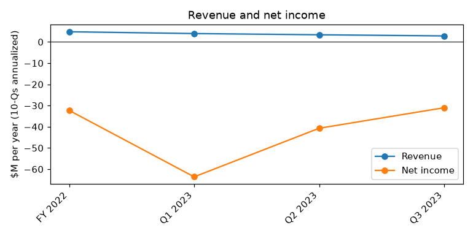
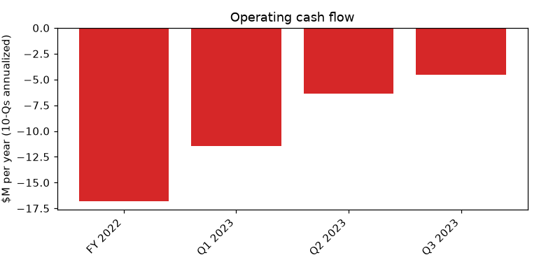
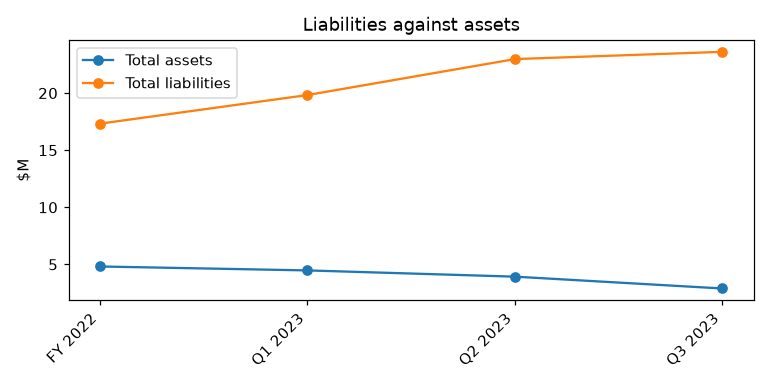

# CREATD, INC. (CIK 1357671): 10-Q for the period ending 2023-09-30, filed 2023-11-15, model score 0.523

## Answer

The score of 0.523 comes from a very large annualized net loss ($31.0M) against only $2.9M of assets, liabilities of 8.2 times assets, and a current ratio of 0.02 against a peer median of 0.35. The filings confirm real distress: cash is $6,759, many notes are in default, and about $4.75M of debentures fall due on February 28, 2024. The model does not see the defaults, so it may understate the risk.

**Verdict:** real risk. **Own risk:** high, about 20%. **Agree with the model:** partly.

## The 8 numbers

| Input | This report ($M) | Year before ($M) | What drives it | Peer percentile |
|---|---|---|---|---|
| Total assets | 2.9 | 8.7 | Shrinking asset base | 30 |
| Current assets | 0.4 | 1.7 | Almost no cash | 38 |
| Current liabilities | 21.7 | 15.2 | Defaulted notes, unpaid bills | 81 |
| Total liabilities | 23.6 | 17.3 | 8.16x assets (peer median 0.85x) | 82 |
| Revenue | 2.8 | 5.3 | Roughly halved | 84 |
| Net income | -31.0 | -31.8 | -1073% of assets | 5 |
| Operating income | -24.5 | -28.0 | Narrowing but large | 19 |
| Operating cash flow | -4.5 | -18.5 | Lower burn, helped by unpaid bills | 23 |

23 peers. Year-before figures are from this filing's prior-year column; income and cash flow annualized.

**Cash:** $6,759 on hand, 0.02 months of cash at the nine-month burn of $0.38M per month. 36% of the $23.3M nine-month loss is non-cash (mostly $8.3M stock compensation); the cash-adjusted loss is $14.9M.

## Main reasons

1. **Huge loss relative to assets** (model input). Net income -$31.0M annualized, -1073% of assets; 5th percentile of 23 peers. No quote; 10-Q, 2023-11-15, financial statements.

2. **Liabilities about eight times assets** (model input). $23.6M vs $2.9M (8.16x); current ratio 0.02. Peer medians 0.85 and 0.35. No quote; 10-Q, 2023-11-15, balance sheet.

3. **Essentially no cash** (from the filings). $6,759, 0.02 months of burn. "its cash position may not be sufficient to support its daily operations." (10-Q, 2023-11-15, Note 3 - Going Concern). Burn looks smaller partly because payables and accruals rose $5,901,097 in nine months.

4. **Defaults on senior secured and other notes** (from the filings). $2,265,447 at 18% default interest, plus the $198,577 PPP loan and many other notes. "As of September 30, 2023, the Company is in default on $2,265,447 in principal on senior secured notes from The July 2022 Convertible Note Offering." (10-Q, 2023-11-15, Part II, Item 3)

5. **About $4.75M of debentures due February 28, 2024** (from the filings). $2,485,000 plus $2,267,140; conversion price cut from $0.20 to $0.025. The holders agreed to "extend the maturity dates for the Debentures, which have a cumulative remaining balance of $2,485,000, to February 28, 2024" (10-Q, 2023-11-15, Note 14 - Subsequent Events; 8-K 2023-11-01).

6. **First-priority lien on all assets** (from the filings). "If we do not have sufficient funds and are otherwise unable to arrange financing, our assets may be foreclosed upon" (10-K, 2023-04-19, Item 1A Risk Factors).

## Evidence against

- 36% of the loss is non-cash: "Stock-based compensation for stock options has been recorded in the consolidated statements of operations and totaled $8,283,267 for the nine months ended September 30, 2023." (10-Q, 2023-11-15, stock options note)
- Lenders extend rather than enforce: "agreed to extend the maturity dates for the Debentures, which have a cumulative remaining balance of $2,267,140 including interest and fees, to February 28, 2024." (8-K, 2023-11-01, Item 1.01)
- Debt is converted into stock: "On October 3, 2023, an investor converted $150,000 in principal of a convertible promissory note into 6,000,000 shares of the Company’s common stock." (10-Q, 2023-11-15, Note 14 - Subsequent Events)
- Small new money keeps arriving ($75,000 equity line, $20,500 PIPE, $100,000 note), though at $0.016-$0.025 per share.
- A $405,208 severance claim was settled for $75,000 cash plus shares (8-K, 2023-11-01).
- Operating cash flow improved from -$18.5M to -$4.5M annualized.
- Inference, not stated in the filings: with mostly convertible creditors, a dilutive workout or quiet wind-down is plausible instead of a court filing.

## How it developed

- 2022-09-02: May 2022 notes default; Nasdaq panel decides to delist.
- 2022-09-19: lenders get a first-priority lien on all assets.
- 2023-04-19: 10-K with auditor going concern paragraph.
- 2023-05-03: auditor changed.
- 2023-09-30: quarter ends with $6,759 cash and many defaults.
- 2023-10-16: CFO resigns; CEO also becomes CFO.
- 2023-11-01: debentures extended to February 28, 2024.
- 2023-11-15: NT 10-Q, then 10-Q with going concern doubt.

## Dates to watch

- 2023-11-30 and 2023-12-11: first monthly payments ($45,416.67 and $47,142.85) on new July 2023 notes.
- 2023-12-15: deferred note payments due.
- 2023-12-23: CEO convertible notes mature.
- 2023-12-31: Second September 2022 Note matures.
- 2024-02-28: about $4.75M of debentures due.
- Fiscal 2023 10-K: late filing or going concern language.

**What would change my mind:** a financing big enough to repay or convert the February 2024 debentures, most debt converted to equity, all defaults cured or waived, or a sale that pays creditors. Toward higher risk: a lender enforcing its lien or suing, or missed late-2023 payments.

## Charts

## How sure I am

Moderate. Could not check: enforcement by any lender after the filing; total debt due within 12 months; how much the equity line can raise near $0.02 per share; whether the January 2023 reverse split happens; how much each input moved the score.

## Filings used

10-Q 2023-11-15; 10-K 2023-04-19; 10-Q 2023-08-14; 10-Q 2023-05-18; NT 10-Q 2023-11-15; 8-K 2023-11-01; 8-K 2023-05-22; NT 10-Q 2023-05-15; 8-K 2023-05-03; NT 10-K 2023-03-31; 8-K 2023-02-10 (three); 8-K 2023-01-20; 8-K 2022-11-18; NT 10-Q 2022-11-14; 8-K 2022-11-07; 8-K 2022-10-25; 8-K 2022-09-26; 8-K 2022-09-19; 8-K 2022-09-09; 8-K 2022-09-06; 8-K 2022-07-29; 8-K 2022-06-07; 8-K 2022-06-03